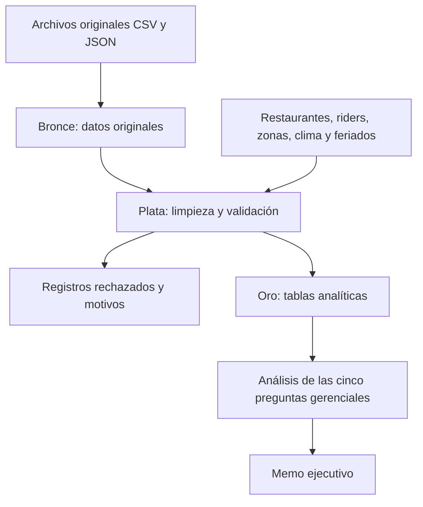

# YaLlegó Delivery — Proyecto Bloque 1

**Universidad Privada Boliviana (UPB)**

- Materia: Introducción a la Ciencia de Datos II
- Docente: Sandra María Abasto
- Gestión: II-2026

## 1. Integrantes

- Urquidi Salinas Guillermo Gabriel
- José [nombre completo]
- Suri [nombre completo]

## 2. Descripción del proyecto

El proyecto consiste en desarrollar un pipeline reproducible para integrar, limpiar, validar y analizar los datos de YaLlegó Delivery correspondientes a la gestión 2025.

Se utiliza una arquitectura de datos de tres capas: bronce, plata y oro. El objetivo es garantizar la calidad de los datos y responder cinco preguntas gerenciales relacionadas con la demanda, el clima, las promociones, las calificaciones y el desempeño de restaurantes y repartidores.

## 3. Tecnologías utilizadas

- Python
- pandas
- DuckDB
- Pandera
- Google Colab
- SQL
- GitHub
- Nager.Date API

## 4. Arquitectura del pipeline



## 5. Instrucciones de ejecución

La ejecución final del proyecto se realizará mediante:

```bash
python pipeline.py
```

Pendiente de completar las instrucciones de instalación y ubicación de los datos después de integrar el pipeline.

Los datos originales y la base de datos generada no se incluyen en el repositorio.

## 6. Puntos de control

| Indicador | Resultado | Estado |
|---|---:|---|
| Archivos originales de pedidos | 12 | Verificado |
| Filas en bronce | 76.232 | Verificado |
| Columnas en bronce | 15 VARCHAR | Verificado |
| Pedidos únicos antes de tratar huérfanos | 75.332 | Pendiente |
| Zonas del catálogo | 12 | Verificado |
| Restaurantes | 40 | Verificado |
| Riders | 120 | Verificado |
| Monto total antes de tratar huérfanos | Bs 4.421.271 ± 1 | Pendiente |
| Días registrados en clima | 365 | Verificado |
| Días con lluvia ≥ 1 mm | 81 | Verificado |
| Filas en oro_diario | 365 | Pendiente |

## 7. Fuente de feriados

Durante la extracción inicial, los feriados de Bolivia correspondientes a 2025 se obtuvieron mediante la API de Nager.Date, recuperando 12 registros.

Se implementó un mecanismo de respaldo mediante el archivo JSON proporcionado, en caso de que la API no esté disponible.

La procedencia utilizada en la ejecución final deberá confirmarse.

## 8. Idempotencia

La capa bronce fue ejecutada dos veces consecutivas:

- Ejecución 1: 76.232 filas.
- Ejecución 2: 76.232 filas.

Pendiente: incorporar la evidencia de dos ejecuciones consecutivas del pipeline completo.

## 9. Atrapé a la IA

### Caso 1

- Solicitud realizada:
- Error cometido por la IA:
- Evidencia numérica:
- Corrección implementada:

### Caso 2

- Solicitud realizada:
- Error cometido por la IA:
- Evidencia numérica:
- Corrección implementada:

## 10. Declaración de uso de inteligencia artificial

Se utilizó inteligencia artificial como herramienta de asistencia para generar código, explicar instrucciones y proponer mecanismos de validación.

Los integrantes verifican los resultados, justifican las decisiones de calidad y elaboran sus propias interpretaciones y conclusiones.

### Prompts principales

Pendiente de incorporar los prompts utilizados por los integrantes.
