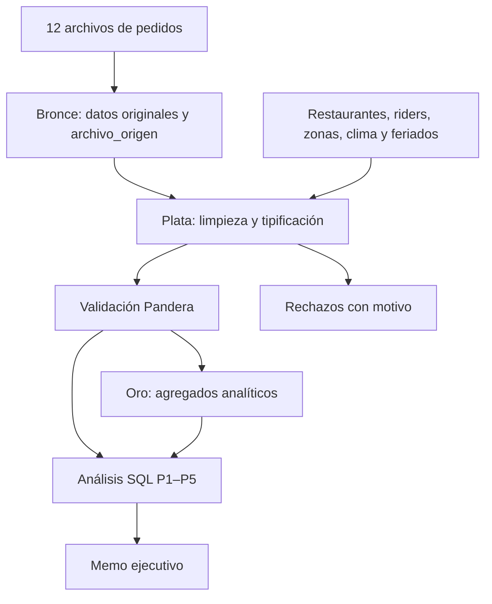

# YaLlegó Delivery — Proyecto del Bloque 1

**Universidad Privada Boliviana (UPB)** · Introducción a la Ciencia de Datos II · Gestión II-2026  
**Docente:** Sandra María Abasto  
**Integrantes:** Urquidi Salinas Guillermo Gabriel, José y Suri (nombres completos no disponibles en los archivos revisados).  
**Período analizado:** 2025. Los datos y nombres corresponden a un caso ficticio del curso.

## 1. Objetivo

Construir un pipeline reproducible que consolide los pedidos y las fuentes complementarias, aplique reglas de calidad y permita responder las cinco preguntas gerenciales de YaLlegó Delivery: demanda y capacidad de riders, lluvia, promoción, calificaciones y desempeño de restaurantes y riders.

## 2. Arquitectura



**Bronce:** apilamiento de 11 CSV y un JSON, como texto, sin eliminar filas; trazabilidad con `archivo_origen`.  
**Plata:** tipificación, deduplicación, homologación de zonas y calificaciones, tratamiento de tiempos inválidos y huérfanos, validaciones y rechazos.  
**Oro:** tablas analíticas; `oro_diario` tiene como grano una fecha. La implementación final de oro corresponde al módulo integrado del equipo, no incluido en esta revisión.

## 3. Estructura prevista del repositorio

```text
yallego-b1/
├── README.md
├── .gitignore
├── pipeline.py
├── bronce.py
├── fuentes.py
├── plata.py
├── esquemas.py
├── oro.py                 # si se mantiene como módulo separado
├── calidad.md
├── analisis.ipynb         # notebook consolidado P1–P5
├── memo.md
└── data/                  # no versionar
```

Los módulos pueden estar integrados en `pipeline.py` si la implementación final así lo dispone. `analisis_gabo.ipynb` es el aporte individual P1/P5 que debe integrarse en `analisis.ipynb`. No subir el ZIP, los datos extraídos ni la base DuckDB a GitHub.

## 4. Reproducción

1. Clonar el repositorio y situarse en su carpeta raíz.
2. Instalar las dependencias (Python 3):

   ```bash
  python -m pip install pandas numpy duckdb pandera openpyxl requests matplotlib seaborn scipy statsmodels
   ```
   

3. Obtener `YaLlego_datos.zip` por el canal autorizado y descomprimirlo. Contiene una carpeta `YaLlego/` con `raw/pedidos/` y los archivos de referencia. Ubicar la carpeta extraída según la ruta configurada en `pipeline.py` (la revisión individual utilizó `YaLlego/`).
4. Ejecutar el pipeline:

   ```bash
   python pipeline.py
   ```

5. Verificar que se genere `yallego.duckdb`, que existan las tablas de las tres capas y que coincidan los controles de la sección siguiente. Ejecutar otra vez y comprobar que los conteos no cambien.
6. Abrir `analisis.ipynb` y ejecutar las celdas de P1–P5 usando la base generada. El aporte de Gabo admite también la base provisional `yallego_analisis.duckdb` cuando no existe la definitiva.

**Estado de esta revisión:** Estado: pipeline integrado (bronce, plata y oro) ejecutado de punta a punta en Colab. Se ejecutó dos veces seguidas con conteos idénticos (ver sección Idempotencia).

## 5. Controles de calidad y reproducibilidad

| Indicador | Resultado | Evidencia / estado |
|---|---:|---|
| Archivos mensuales | 12 | Perfilado ejecutado en Colab |
| Filas originales | 76.232 | Bronce ejecutada en Colab |
| Columnas bronce | 15 VARCHAR | DESCRIBE en Colab |
| Pedidos únicos antes de huérfanos | 75.332 | Limpieza de José, cotejo previo |
| Monto antes de huérfanos | Bs 4.421.271,12 | Cotejo previo de limpieza |
| Pedidos finales en plata | 75.192 | Recalculado con `plata.py` |
| Rechazos | 1.040 | Recalculado; 900 duplicados y 140 huérfanos |
| Monto de comida en plata (todos los estados) | Bs 4.413.314,04 | Recalculado con `plata.py` |
| Zonas | 12 | Extracción en Colab |
| Restaurantes | 40 | Extracción en Colab |
| Riders | 120 | Extracción en Colab |
| Días de clima | 365 | Extracción en Colab |
| Días con lluvia ≥ 1 mm | 81 | Extracción en Colab |
| Feriados | 12, API | Extracción inicial en Colab |
| Filas de oro_diario | 365 | Verificado en Colab, ejecución final del pipeline |
| Pandera: caso válido y calificación 7 | — | Incorporar evidencia de José |

La conciliación de filas es 76.232 = 75.192 + 900 + 140. Los pedidos con tiempos inválidos se conservan; solo se anula el tiempo y se marca `tiempo_invalido`. Las decisiones y justificaciones se documentan en `calidad.md`. El universo de análisis excluye R041 por decisión del equipo; no equivale al total de pedidos originales deduplicados.

### Idempotencia

El pipeline completo (bronce, plata y oro) se ejecutó dos veces seguidas desde cero. Los conteos fueron idénticos:

| Tabla | Ejecución 1 | Ejecución 2 |
|---|---|---|
| bronce_pedidos | 76232 | 76232 |
| plata_pedidos | 75192 | 75192 |
| rechazos_pedidos | 1040 | 1040 |
| plata_restaurantes | 40 | 40 |
| plata_riders | 120 | 120 |
| plata_zonas | 12 | 12 |
| plata_clima | 365 | 365 |
| plata_feriados | 12 | 12 |
| oro_diario | 365 | 365 |
| oro_pedidos_enriquecido | 75192 | 75192 |

El pipeline borra yallego.duckdb al empezar y usa CREATE OR REPLACE TABLE, por eso la segunda ejecución no duplica filas.

Evidencia (capturas de Colab):

        


### Procedencia de los feriados

En la extracción inicial, Nager.Date respondió correctamente con 12 registros para Bolivia en 2025 (`api`). El código intenta la API y utiliza el archivo de respaldo ante fallo. Registrar la fuente que efectivamente imprima el pipeline definitivo (`api` o `respaldo`).
En la ejecución final del pipeline integrado, los feriados provinieron de la API (api).
Fuente de feriados

En la ejecución final los feriados vinieron de la API de Nager.Date (12 registros). El pipeline guarda la fuente en la columna fuente de plata_feriados y la imprime al inicio. Si la API falla usa feriados_bo_2025_respaldo.json

## 6. Análisis gerencial

El notebook individual P1/P5 conserva consultas SQL, gráficos y criterios; incluye un anexo ejecutado con pandas sobre el ZIP y la limpieza de José, con cuatro gráficos y los siguientes resultados de referencia:

- P1: sábado 13:00–13:59, 34,10 pedidos por ocurrencia; Centro 10.559 pedidos (14,04 %); estimación de 19 riders para toda la operación en la franja típica con utilización del 80 %; escenario de máximo histórico, 40 riders.
- P5: R017, Burger Kanata Express, 386 cancelaciones de 2.576 pedidos (14,98 %; referencia general 4,79 %). RD046, Marco Rocha, 29,75 min en 572 entregas con tiempo válido (referencia 25,10 min). Los rankings señalan casos para investigar, no responsabilidad causal.

Los datos del anexo se recalcularon con pandas; el cotejo de las consultas SQL debe ejecutarse en Colab. Como contraste para el memo, el segundo anexo incluye P2–P4 calculadas independientemente con la misma limpieza: lluvia (+43,53 pedidos/día, +8,76 min, −0,34 estrellas; p < 0,001 en los tres contrastes Welch), promoción (DiD +66,33 pedidos y −Bs 1.516 de ingreso bruto estimado por miércoles), calificaciones (r = −0,539 entre duración y calificación, r = −0,453 tras centrar por zona). No se atribuyen estos cálculos a José ni Suri y no sustituyen sus análisis SQL.

## 7. Declaración de uso de inteligencia artificial

**Herramienta:** ChatGPT (OpenAI). **Alcance de esta declaración:** trabajo de Gabo; José y Suri deben añadir sus propios usos y prompts antes de la entrega.

Se utilizó IA para planificar el trabajo, generar y explicar código Python/SQL, estructurar las consultas P1 y P5, proponer validaciones y criterios analíticos, y preparar la documentación técnica. El perfilado, la carga bronce y la extracción de fuentes fueron ejecutados en Colab por el integrante, quien contrastó los resultados con los puntos de control. Se comprobaron 12 archivos, 76.232 filas en bronce, 15 columnas VARCHAR, dos ejecuciones con igual conteo, 40 restaurantes, 120 riders, 12 zonas, 365 registros climáticos, 81 días con lluvia ≥ 1 mm y 12 feriados obtenidos inicialmente por API.

La IA propuso los mínimos de 100 pedidos para restaurantes y 50 entregas válidas para riders, además del supuesto de utilización de 80%. Los análisis de referencia utilizan dichos criterios; el equipo debe ratificarlos o modificarlos y justificarlo. Las consultas están preparadas y los indicadores se recalcularon mediante pandas con el script de José; falta cotejar la ejecución SQL en Colab con la base definitiva. La IA también generó propuestas de redacción gerencial, revisión crítica y borrador del memo a solicitud del integrante. Se declara expresamente esta asistencia; la guía exige que las interpretaciones y el memo final sean redactados por el equipo, por lo que corresponde a los integrantes revisar, reformular y asumir sus propias conclusiones antes de entregar.
### Declaración de Suri

Herramienta: Claude. Se usó IA para generar el código de oro.py y pipeline.py, las consultas de P2 y P3, y para explicar cómo usar GitHub y Colab. Los resultados se verificaron con los puntos de control 365 filas en oro_diario, 81 días con lluvia, 75.192 filas en plata_pedidos,y con dos ejecuciones completas del pipeline con conteos idénticos. Las interpretaciones de P2 y P3 son propias.


### Prompts principales utilizados por Gabo 

| Solicitud | Uso de la IA |
|---|---|
| «Divide el desarrollo del proyecto en tres partes equitativas para tres integrantes: Gabo, José y Suri» | Distribución de misiones y responsabilidades. |
| «Desarrollemos paso a paso la parte de Gabo» | Orientación y generación de código para perfilado, bronce y fuentes complementarias. |
| «En septiembre de como sabes desde que fecha cambia la calificación? No te saltes pasos.» | Solicitud de evidencia para identificar el cambio de escala de calificación. |
| «Preparemos las consultas SQL y definir los criterios de análisis» | Preparación de SQL, gráficos y criterios P1/P5. |
| «Prepara mi archivo con las consultas SQL, gráficos y criterios de P1 y P5.» | Revisión y corrección del notebook, documentación de IA y estructura del memo. |

## Prompts utilizados por Suri como apoyo de IA 

| Solicitud | Uso de la IA |
|---|---|
| Estoy trabajando en la capa oro del proyecto YaLlegó Delivery y necesito integrar las tablas provenientes de plata. ¿Podrías ayudarme a desarrollar el archivo `oro.py` utilizando Pandas y DuckDB? Necesito que relaciones correctamente los pedidos con restaurantes, repartidores, zonas y clima, generes las tablas necesarias para los análisis y agregues verificaciones para evitar duplicaciones o pérdida de registros. Explícame también cómo funciona cada parte del código. | Desarrollo y explicación del código de `oro.py`. |
| Necesito crear el archivo `pipeline.py` para integrar las diferentes etapas de nuestro proyecto. ¿Cómo puedo organizar el proceso para que se ejecute primero la capa bronce, después plata y finalmente oro? Dame el código adaptado a la estructura de nuestros archivos y explícame cómo ejecutar el pipeline y comprobar que funciona correctamente. | Desarrollo del código de `pipeline.py` e integración de las capas. |
| Para el análisis P2 necesito determinar si los días de lluvia influyen en los pedidos de delivery. Ayúdame a plantear las hipótesis, seleccionar las variables que debo comparar y realizar una prueba estadística en Python. Explícame cómo interpretar los resultados y el p-valor. | Consultas, prueba de hipótesis y gráficos de P2. |
| Para el análisis P3 necesito evaluar si la promoción "Miércoles sin envío", iniciada el 2 de julio de 2025, tuvo algún efecto en los pedidos. Quiero utilizar el método de diferencias en diferencias. Explícame cómo identificar los grupos de tratamiento y control, desarrollar el código en Python, generar gráficos e interpretar los resultados obtenidos. | Consultas, implementación de diferencias en diferencias y gráficos de P3. |


## 8. Atrapé a la IA — dos casos reproducibles

Los siguientes errores corresponden a respuestas reales de ChatGPT. La evidencia se reprodujo en la revisión del notebook con el ZIP original y quedó guardada en el anexo de `analisis_gabo.ipynb`. Se distingue la comprobación realizada por IA del cotejo personal de Gabo, que debe ratificarse antes de entregar. Son pruebas sobre datos originales, no resultados finales de plata.


### Error identificado y corrección en la capa oro

- **Solicitud realizada:** construir `oro_diario` y la tabla enriquecida antes de conocer las columnas reales de `plata_pedidos`.
- **Error cometido por la IA:** asumió nombres de columnas que no existían, como `fecha` en lugar de `fecha_hora` y `restaurante_id` en lugar de `cod_rest`, dejando estos supuestos marcados como `# AJUSTAR`.
- **Evidencia:** al revisar los archivos `plata.py` y `esquemas.py` desarrollados por José, se identificaron los nombres reales de las columnas: `fecha_hora` y `cod_rest`. Sin estos ajustes, el `JOIN` con la tabla de restaurantes habría fallado.
- **Corrección implementada:** se reescribió la función `construir_oro` utilizando los nombres reales de las columnas y adaptando las relaciones entre las tablas.
- **Resultado:** la tabla `oro_pedidos_enriquecido` quedó con 75.192 filas, la misma cantidad de registros que `plata_pedidos`, comprobando que la integración no generó duplicaciones ni pérdida de registros.


### Caso 1. Gráfico de septiembre incompleto

- **Solicitud:** demostrar a partir de los datos la fecha del cambio de escala de calificaciones.
- **Error:** el gráfico ilustrativo generado por la IA omitió el 5 de septiembre. El código de agrupación sí incluía todos los días; el error estaba en el gráfico manual presentado en el chat.
- **Evidencia:** septiembre tiene 30 fechas distintas; el gráfico ilustrativo mostraba 29. El 5 de septiembre sí existe: 241 pedidos y calificación máxima de 5. El 15 de septiembre la máxima pasa a 10.
- **Corrección:** utilizar exclusivamente el gráfico generado directamente por `groupby` sobre los datos, sin introducir manualmente fechas o máximos. La fecha inferida del cambio se mantiene en 2025-09-15.

### Caso 2. Exclusión de calificaciones válidas por un filtro de tiempos

- **Solicitud:** preparar el ranking de riders por tiempo promedio, con calificación media como contexto.
- **Error:** la primera consulta P5 colocaba el criterio de tiempo válido en `WHERE`; por tanto, el promedio de calificación y su conteo se calculaban solo entre las entregas con tiempos válidos, aunque una calificación pudiera ser válida por sí misma.
- **Evidencia:** en agosto hay 4.554 calificaciones no nulas de entregas con rider catalogado. Al filtrar también por tiempo > 0 y < 999, quedan 4.442. Se excluyen 112 calificaciones válidas (afecta a la cobertura del indicador). Si la capa plata conserva esas entregas y convierte tiempos anómalos a nulo, la consulta anterior seguiría excluyéndolas; si las elimina, el efecto en plata puede ser distinto.
- **Corrección:** aplicar filtros dentro de cada agregado (`AVG(...) FILTER (WHERE ...)`, `COUNT(...) FILTER (WHERE ...)`) y aplicar el mínimo de 50 únicamente al número de entregas con tiempo válido. Se implementó en `analisis_gabo.ipynb`; además se alineó el rango válido a 1–120 minutos conforme al esquema de José. El cálculo independiente en pandas ya usa ese rango; falta cotejar la ejecución SQL.

### Código para verificar personalmente los dos casos

Ejecutar en el notebook de perfilado, donde ya están definidos `meses` y `ruta_base`:

```python
# Caso 1: comprobar el día omitido en el gráfico ilustrativo
sept = meses['09'].copy()
sept['fecha'] = pd.to_datetime(sept['fecha_hora']).dt.normalize()
maximos = sept.groupby('fecha')['calificacion'].max()
dia5 = sept[sept['fecha'] == pd.Timestamp('2025-09-05')]
print('Fechas distintas:', len(maximos))
print('Pedidos del día 5:', len(dia5))
print('Máxima del día 5:', dia5['calificacion'].max())
print('Primer día con máxima superior a 5:', maximos[maximos > 5].index.min())
assert len(maximos) == 30 and len(dia5) == 241
maximos.plot(marker='o', title='Calificación máxima diaria — septiembre')
```

```python
# Caso 2: verificar cobertura de calificaciones en agosto
import json
with open(ruta_base / 'riders_api.json', encoding='utf-8') as f:
    ids_riders = {r['id'] for r in json.load(f)['data']}
ago = meses['08']
base = (ago['estado'] == 'entregado') & ago['rider_id'].isin(ids_riders)
tiempo_valido = ago['tiempo_entrega_min'].gt(0) & ago['tiempo_entrega_min'].lt(999)
calif_total = ago.loc[base, 'calificacion'].count()
calif_filtrada = ago.loc[base & tiempo_valido, 'calificacion'].count()
print('Calificaciones de entregas:', calif_total)
print('Calificaciones tras filtro de tiempo:', calif_filtrada)
print('Calificaciones excluidas:', calif_total - calif_filtrada)
assert (calif_total, calif_filtrada) == (4554, 4442)
```


## 9. Estado de integración y alcance de la evidencia
El pipeline integrado fue verificado de punta a punta: 365 filas en oro_diario, 81 días con lluvia, 75.192 filas en plata_pedidos, Pandera validada y dos ejecuciones con conteos idénticos. Los análisis de P2 y P3 están en analisis_suri.ipynb. La consolidación de los cinco análisis está en analisis.ipynb.
